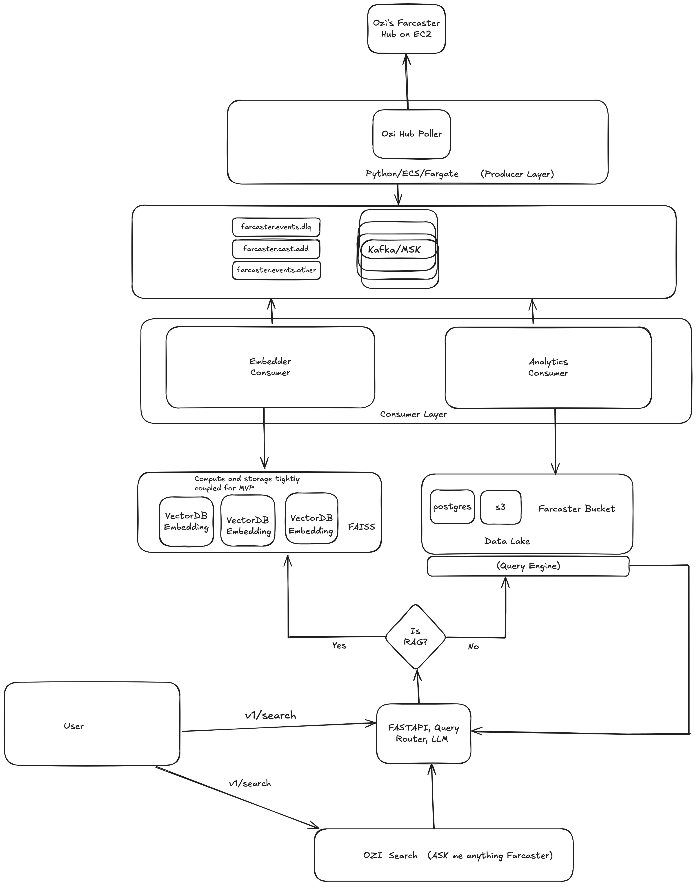

# Ozi

**Ozi** is a real-time semantic search and analytics engine for decentralized social networks, starting with [Farcaster](https://www.farcaster.xyz).

It streams casts, comments, and reactions from live events, embeds them for semantic retrieval, and stores structured event data for analytic SQL queries—all powered by Kafka, Postgres, Qdrant, and LLMs.
Note: This repository contains only the local development environment for the MVP, run with Docker Compose. You may encounter reliability and availability issues as data scales, due to throughput and latency limitations inherent in the current Python-based implementation. We plan to rewrite several lower-level components in Rust as demand increases to improve performance and reduce latency.





---

## Architecture Overview

| Component | Description |
|-----------|-------------|
| **Kafka Producers** | Poll and publish Farcaster events into Kafka topics |
| **Kafka Consumers** | Consume events and write structured data into Postgres and Qdrant |
| **Postgres** |  relational and lightweight analytic queries |
| **Vector Database (Qdrant)** | Stores text embeddings for semantic search |
| **Redis** | Caches `/search` responses for an hour |
| **FastAPI Server** | Serves APIs for semantic search and structured analytics |
| **LLM Service (OpenAI)** | Classifies user queries and generates SQL if needed |
| **RAG Layer** | Powers retrieval-augmented generation over event streams |


##  System Guarantees

Ozi's data ingestion and analytics pipeline is designed to prioritize:

---

### 1. High Availability (HA)

- The poller, both consumers and the API **restart automatically** (Docker restart policies) after a crash.
- The poller **reconnects** to the Snapchain node every 3 seconds when the stream drops.
- The analytics consumer **reconnects** to Postgres when the connection is lost.
- After a restart, each consumer **resumes** from its last committed Kafka offset.

---

### 2. Reliability

- **Live events only**: the poller subscribes from "now". Events emitted while it is down are not backfilled.
- **Bulk insertion**: Records are buffered in memory and inserted in batches of 100 (per event type for Postgres, per 100 casts for Qdrant).
- **Possible loss on stop or crash**: Kafka offsets are auto-committed while events are still in the in-memory buffer, and buffers are not flushed on shutdown, so up to one batch can be lost when a consumer stops. Delivery is therefore not strictly at-least-once.
- **Idempotent inserts**: Postgres rows are keyed by event id with `ON CONFLICT DO NOTHING`, so replayed events do not create duplicates.

---

### 3. Eventual Consistency

- Ozi is designed to be **eventually consistent**:  
  Farcaster events (casts, comments, reactions) appear in Postgres once their batch fills, barring the loss case above.
- **Small ingestion delays are acceptable** in favor of higher throughput. On a quiet stream, recent events are not queryable until a batch of 100 fills.
- Other event types are published to Kafka but ignored by the consumers; unhandled ones go to `farcaster.events.dlq`, which nothing reads yet.

---

### 4. System Principles

| Principle | How Ozi Achieves It |
|:---|:---|
| High Availability | Services restart automatically; the poller and analytics consumer reconnect to their upstreams. |
| Eventual Consistency | Message arrival order is not strictly enforced; ingestion lags by up to one batch. |
| Efficient Batching | Messages are buffered by type and bulk inserted. |
| Graceful Degradation | If traffic spikes, consumers fall behind and catch up from Kafka rather than dropping messages. |
| Minimal Operator Overhead | Restart policies and automatic reconnection; no manual recovery steps. |

---

## Microservices and Components

- **producers/** — Snapchain gRPC poller: transforms events and publishes them to Kafka
- **analytics/** — Kafka consumer writing casts, comments and reactions to Postgres
- **consumers/** — Kafka consumer embedding casts into Qdrant
- **rag/api/** — FastAPI app (`main.py`), vector search service, LLM prompts, SQL validator
- **rag/llm/** — Pluggable LLM layer (OpenAI for now, self-hosted later)

---
## Data Flow

Snapchain node → Poller → Kafka topics (`farcaster.events.add` for casts, `farcaster.events.other` for the rest)
Kafka consumers → Postgres (casts/comments/reactions) + Qdrant (cast embeddings)
FastAPI → /search → LLM classifies → (Semantic search OR SQL generation)
FastAPI → /query → Full analytic query results


## Use Cases & Example Queries

Ozi lets you explore Farcaster activity in real-time whether you're a researcher, builder, or curious user.

**Use Cases (WIP):**
- Query Casts via natural language
- Run custom analytics on Farcaster events
- Build dashboards or agents over social data
- Warpcast-integrated search and summarization

---

### Ask Anything

You can interact with Ozi using natural language or SQL. The LLM will translate your questions into queries against the analytics engine. The UI layer will paginate the results (top 5).

**Try asking:**
- _"Which Farcaster users mentioned “Ethereum” the most this week?"_
- _"What are the top topics being discussed about Solana today?"_
- _"Show me all users who cast about tariffs in the last 7 days."_

**Example SQL generated:**

```sql
SELECT
  fid,
  COUNT(*) AS cast_count
FROM casts
WHERE text ILIKE '%tariff%'
  AND idx_time >= NOW() - INTERVAL '7 days'
GROUP BY fid
ORDER BY cast_count DESC
LIMIT 10;
```

**Example API calls** (replace `8000` with `API_HOST_PORT` if you changed it):

```bash
# 1. Register a user (required once; creates the quota row)
curl -X POST http://localhost:8000/auth \
  -H "Content-Type: application/json" \
  -d '{"fid": "123"}'

# 2. Natural-language search ("general" filters to the user's own activity, "deep" searches everything)
curl -X POST http://localhost:8000/search \
  -H "Content-Type: application/json" \
  -d '{"query": "What are people saying about Ethereum?", "fid": "123", "search_mode": "deep"}'

# 3. Run a read-only SQL query directly
curl -G http://localhost:8000/query \
  --data-urlencode "fid=123" \
  --data-urlencode "sql=SELECT fid, COUNT(*) AS cast_count FROM casts GROUP BY fid ORDER BY cast_count DESC LIMIT 10;"
```
---

## Technologies Used

- **[FastAPI](https://fastapi.tiangolo.com/)** — High-performance Python web framework for building APIs
- **[Postgres](https://www.postgresql.org/)** — Database for lightweight analytical queries on structured data
- **[Kafka](https://kafka.apache.org/)** — Distributed event streaming platform for ingesting real-time events
- **[Qdrant](https://qdrant.tech/)** — Vector database for semantic search over cast embeddings
- **[Redis](https://redis.io/)** — Response cache for search queries
- **[Sentence-Transformers](https://www.sbert.net/)** — Text embedding models for semantic similarity search
- **[OpenAI / ChatGPT APIs](https://platform.openai.com/)** — Language model service for query classification and SQL generation
- **[Docker + Docker Compose](https://docs.docker.com/compose/)** — Containerization and local orchestration of services


## API Endpoints

| Method | Path | Purpose |
|--------|------|---------|
| `POST` | `/auth`    | Register a user by `fid` and return remaining quotas |
| `POST` | `/search`  | Natural-language search (`query`, `fid`, `search_mode` = `general` or `deep`) |
| `GET`  | `/query`   | Run a validated read-only SQL query (`sql`, `fid`) |
| `GET`  | `/health`  | Health check to verify the API can reach Postgres |
| `GET`  | `/queries` | Returns the most recent queries received by Ozi (default 100) |

There is no web UI; the API is JSON only.


## Getting Started

Requirements: Docker (with Compose), `make` and `git`. No host Python is needed.

#### 1. Clone

```bash
git clone https://github.com/ashnet16/ozi-backend.git
cd ozi-backend
```

#### 2. Configure

```bash
cp .env.example .env
```

Fill in `POSTGRES_USER`, `POSTGRES_PASSWORD` and `OPENAI_API_KEY`. Optionally set:

- `POSTGRES_HOST_PORT`, `REDIS_HOST_PORT`, `API_HOST_PORT` if 5432 / 6379 / 8000 are already in use
- `SNAPCHAIN_ENDPOINT` — gRPC address of the Snapchain node the poller subscribes to (default `host.docker.internal:3383`, i.e. a node running on your machine)

#### 3. Choose a Snapchain node

The poller needs a Snapchain node to read events from. There are two options.

**Local test network (included).** The project can run Snapchain's own 4-node devnet on your machine. It is a private network with no real Farcaster data: the only casts on it are the ones you submit, which makes it suitable for testing the pipeline end to end.

```bash
make snapchain-up     # first run compiles Snapchain from source and is slow
make snapchain-logs   # follow node 1
make snapchain-down   # stop it
```

Node 1 serves gRPC on `localhost:3383` and HTTP on `localhost:3381`. The poller's default endpoint already points at it, so no configuration is needed. Check it with `curl http://localhost:3381/v1/info`.

Startup notes:

- **Give Docker enough memory first.** With 8 GB allotted to Docker the build ran out of memory and Docker killed running containers. With 24 GB it built cleanly alongside the Ozi stack. On Docker Desktop this is Settings > Resources > Memory.
- **The first run takes about 35 minutes.** Measured on a 14-core Apple-silicon Mac: about 29 minutes compiling Snapchain's Rust dependencies and 6 minutes compiling Snapchain itself. There is no prebuilt devnet image; the published `farcasterxyz/snapchain` image has no devnet configuration.
- **Later runs take seconds.** The image is cached (about 385 MB), and the nodes answer on `/v1/info` within about 20 seconds of starting.
- **Ports used:** 3381 and 3383 to 3386 (TCP), 50051 to 50054 (UDP).
- **The network starts empty.** See the Developer Guide below for registering test accounts and submitting casts.

**Your own endpoint (optional).** To read from another node, for example a hosted node or a mainnet node you run elsewhere, set these in `.env`:

| Variable | Purpose |
|:---|:---|
| `SNAPCHAIN_ENDPOINT` | `host:port` of the node's gRPC service. An `https://` prefix turns TLS on. |
| `SNAPCHAIN_USE_TLS` | `true` to use TLS when the endpoint has no `https://` prefix. |
| `SNAPCHAIN_API_KEY` | API key, if the provider requires one. |
| `SNAPCHAIN_API_KEY_HEADER` | Header the key is sent in (default `x-api-key`). |

Then restart the poller: `docker compose up -d poller`.

Running your own mainnet node needs 16 GB of RAM and 1.5 TB of free disk; see the [Snapchain repository](https://github.com/farcasterxyz/snapchain).

#### 4. Build and run

```bash
make setup
```

This clones the Snapchain repo for its `.proto` files, builds the images (the protos are compiled inside the poller image) and starts everything. The first build and first start are slow: the images include PyTorch and the embedding model is downloaded on startup.

#### 5. Query the API at http://localhost:8000 (see the example calls above)


#### Below are the Kafka Topics

```
kafka-topics --bootstrap-server localhost:9092 \
  --create --topic farcaster.events.add --partitions 1 --replication-factor 1

kafka-topics --bootstrap-server localhost:9092 \
  --create --topic farcaster.events.other --partitions 1 --replication-factor 1

kafka-topics --bootstrap-server localhost:9092 \
  --create --topic farcaster.events.dlq --partitions 1 --replication-factor 1
```

#### Consume inside the container
```
kafka-console-consumer \
  --bootstrap-server localhost:9092 \
  --topic farcaster.events.add \
  --from-beginning \
  --property print.key=true \
  --property print.value=true

```

## Developer Guide

### Applying code changes

Not every service picks up edits the same way. Service names are the ones in `docker-compose.yml`.

| Service | Code | After editing |
|:---|:---|:---|
| `poller` | `producers/` | `docker compose build poller && docker compose up -d poller` |
| `semantic-consumer` | `consumers/` | `docker compose build semantic-consumer && docker compose up -d semantic-consumer` |
| `consumer` (analytics) | `analytics/`, `consumers/` | `docker compose restart consumer` |
| `ozi-api` | `rag/` | `docker compose restart ozi-api` |

The poller and the semantic consumer run the copy of the code built into their image, so they need a rebuild. The other two run the mounted source and only need a restart.

### Testing against the local Snapchain network

The devnet starts with no accounts and no casts. Snapchain's `fc` CLI, which is inside the node containers, creates both. Run these from the `snapchain/` folder.

Register two test accounts (fids). The command prints a signer secret for each; keep them for the next step.

```bash
docker compose exec -T node1 ./fc devnet bootstrap \
  --network devnet --node http://localhost:3381 --grpc-node http://localhost:3383 \
  --auth dev:dev --fid 1001 --count 2
```

Submit a cast, and a follow:

```bash
docker compose exec -T node1 ./fc cast-add \
  --network devnet --node http://localhost:3381 \
  --fid 1001 --signer-secret <secret for 1001> --text "hello from the devnet"

docker compose exec -T node1 ./fc link add \
  --network devnet --node http://localhost:3381 \
  --fid 1002 --target-fid 1001 --signer-secret <secret for 1002>
```

Each fid lives on one shard, so using two or more fids exercises more than one shard.

### Following an event through the pipeline

```bash
# 1. Poller published it
docker logs --since 1m ozi-poller | grep "Sent event"

# 2. It is in Kafka (message counts per topic)
docker exec kafka kafka-run-class kafka.tools.GetOffsetShell \
  --bootstrap-server localhost:9092 --topic 'farcaster.events.*'

# 3. It is in Postgres
docker exec ozi-postgres psql -U <POSTGRES_USER> -d ozi \
  -c "select fid, left(text, 40) from casts order by idx_time desc limit 5"

# 4. It is in Qdrant
curl -s localhost:6333/collections/farcaster_casts
```

Both consumers write only when 100 events have been buffered. A handful of test casts will reach Kafka but will not appear in Postgres or Qdrant until the batch fills, so submit at least 100 to test those stages.

### Linting and formatting

These run on the host and need [Poetry](https://python-poetry.org/) (`poetry install` once):

```bash
make format       # black and isort
make lint         # flake8
make type-check   # mypy
```

There is no automated test suite yet.

### Troubleshooting

- **Kafka exits with `NodeExistsException` after Docker restarts.** Its previous registration in Zookeeper has not expired yet. Wait about 20 seconds and run `docker compose up -d kafka`.
- **The poller logs "failed to connect" in a loop.** No node is listening at `SNAPCHAIN_ENDPOINT`. Start the devnet with `make snapchain-up` or check the endpoint.
- **Containers exit with code 137.** Docker ran out of memory. Raise Docker's memory limit.
- **Port 8000, 5432 or 6379 is already in use.** Set `API_HOST_PORT`, `POSTGRES_HOST_PORT` or `REDIS_HOST_PORT` in `.env`.
- **`/search` returns 500.** Check that `OPENAI_API_KEY` in `.env` is a real key; `docker logs ozi-api` shows the error.
