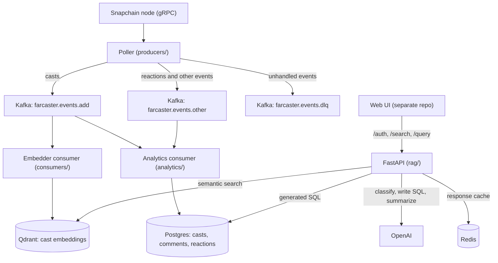

# Ozi

**Ozi** is a real-time semantic search and analytics engine for decentralized social networks, starting with [Farcaster](https://www.farcaster.xyz).

It streams casts, comments, and reactions from live events, embeds them for semantic retrieval, and stores structured event data for analytic SQL queries—all powered by Kafka, Postgres, Qdrant, and LLMs.
Note: This repository contains only the local development environment for the MVP, run with Docker Compose. You may encounter reliability and availability issues as data scales, due to throughput and latency limitations inherent in the current Python-based implementation. We plan to rewrite several lower-level components in Rust as demand increases to improve performance and reduce latency.

This repository (`ozi-backend`) is the backend: ingestion, storage and the JSON API. The web UI lives in a separate repository and talks to this API.





---

## Architecture Overview

| Component | Description |
|-----------|-------------|
| **Kafka Producers** | Poll and publish Farcaster events into Kafka topics |
| **Kafka Consumers** | Consume events and write structured data into Postgres and Qdrant |
| **Postgres** |  relational and lightweight analytic queries |
| **Vector Database (Qdrant)** | Stores text embeddings for semantic search |
| **Redis** | Caches `/search` responses for an hour |
| **FastAPI Server** | Serves APIs for semantic search and structured analytics |
| **LLM Service (OpenAI)** | Classifies user queries and generates SQL if needed |
| **RAG Layer** | Powers retrieval-augmented generation over event streams |


## System Behaviour

What the current MVP does and does not guarantee.

### Availability

- The poller, both consumers and the API restart automatically if they crash or lose a startup race with Kafka or Postgres.
- The poller reconnects to the Snapchain node every 3 seconds when the stream drops.
- The analytics consumer reconnects to Postgres when the connection is lost.

### Delivery

- **Live events only**: the poller subscribes from "now". Events emitted while it is down are not backfilled.
- **Batched writes**: events are buffered in memory and written in batches of 100 (per event type for Postgres, per 100 casts for Qdrant). On a quiet stream, recent events are not queryable until a batch fills.
- **Possible loss on stop or crash**: Kafka offsets are auto-committed while events are still in the buffer, and there is no flush on shutdown, so up to one batch can be lost when a consumer stops.
- **Idempotent inserts**: Postgres rows are keyed by event id with `ON CONFLICT DO NOTHING`, so replayed events do not create duplicates.

### Consistency

- Eventually consistent: arrival order is not enforced and ingestion lags by up to one batch.
- Only casts, comments and reactions are stored. Other event types are published to Kafka but ignored by the consumers; unhandled ones go to `farcaster.events.dlq`, which nothing reads yet.

---

## Microservices and Components

- **producers/** — Snapchain gRPC poller: transforms events and publishes them to Kafka
- **analytics/** — Kafka consumer writing casts, comments and reactions to Postgres
- **consumers/** — Kafka consumer embedding casts into Qdrant
- **rag/api/** — FastAPI app (`main.py`), vector search service, LLM prompts, SQL validator
- **rag/llm/** — Pluggable LLM layer (OpenAI for now, self-hosted later)

---
## Data Flow

Snapchain node → Poller → Kafka topics (`farcaster.events.add` for casts, `farcaster.events.other` for the rest)
Kafka consumers → Postgres (casts/comments/reactions) + Qdrant (cast embeddings)
FastAPI → /search → LLM classifies → (Semantic search OR SQL generation)
FastAPI → /query → Full analytic query results


## Use Cases & Example Queries

Ozi lets you explore Farcaster activity in real-time whether you're a researcher, builder, or curious user.

**Use Cases (WIP):**
- Query Casts via natural language
- Run custom analytics on Farcaster events
- Build dashboards or agents over social data
- Warpcast-integrated search and summarization

---

### Ask Anything

You can interact with Ozi using natural language or SQL. The LLM will translate your questions into queries against the analytics engine. The UI (separate repository) paginates the results (top 5).

**Try asking:**
- _"Which Farcaster users mentioned “Ethereum” the most this week?"_
- _"What are the top topics being discussed about Solana today?"_
- _"Show me all users who cast about tariffs in the last 7 days."_

**Example SQL generated:**

```sql
SELECT
  fid,
  COUNT(*) AS cast_count
FROM casts
WHERE text ILIKE '%tariff%'
  AND idx_time >= NOW() - INTERVAL '7 days'
GROUP BY fid
ORDER BY cast_count DESC
LIMIT 10;
```

**Example API calls** (replace `8000` with `API_HOST_PORT` if you changed it):

```bash
# 1. Register a user (required once; creates the quota row)
curl -X POST http://localhost:8000/auth \
  -H "Content-Type: application/json" \
  -d '{"fid": "123"}'

# 2. Natural-language search ("general" filters to the user's own activity, "deep" searches everything)
curl -X POST http://localhost:8000/search \
  -H "Content-Type: application/json" \
  -d '{"query": "What are people saying about Ethereum?", "fid": "123", "search_mode": "deep"}'

# 3. Run a read-only SQL query directly
curl -G http://localhost:8000/query \
  --data-urlencode "fid=123" \
  --data-urlencode "sql=SELECT fid, COUNT(*) AS cast_count FROM casts GROUP BY fid ORDER BY cast_count DESC LIMIT 10;"
```
---

## Technologies Used

- **[FastAPI](https://fastapi.tiangolo.com/)** — High-performance Python web framework for building APIs
- **[Postgres](https://www.postgresql.org/)** — Database for lightweight analytical queries on structured data
- **[Kafka](https://kafka.apache.org/)** — Distributed event streaming platform for ingesting real-time events
- **[Qdrant](https://qdrant.tech/)** — Vector database for semantic search over cast embeddings
- **[Redis](https://redis.io/)** — Response cache for search queries
- **[Sentence-Transformers](https://www.sbert.net/)** — Text embedding models for semantic similarity search
- **[OpenAI / ChatGPT APIs](https://platform.openai.com/)** — Language model service for query classification and SQL generation
- **[Docker + Docker Compose](https://docs.docker.com/compose/)** — Containerization and local orchestration of services


## Project Status

> Ozi is in early WIP. We’re building in public and welcoming feedback.

- [x] Kafka ingestion
- [x] Embedder master for LLM-based indexing
- [x] Query API (FastAPI)
- [ ] Analytics / dashboarding
- [ ] Warpcast frame integration
- [ ] Token/gov idea experiments

---

## API Endpoints

| Method | Path | Purpose |
|--------|------|---------|
| `POST` | `/auth`    | Register a user by `fid` and return remaining quotas |
| `POST` | `/search`  | Natural-language search (`query`, `fid`, `search_mode` = `general` or `deep`) |
| `GET`  | `/query`   | Run a validated read-only SQL query (`sql`, `fid`) |
| `GET`  | `/health`  | Health check to verify the API can reach Postgres |
| `GET`  | `/queries` | Returns the most recent queries received by Ozi (default 100) |

This repository serves the JSON API only; the web UI that calls it lives in a separate repository.


## Getting Started

Requirements: Docker (with Compose), `make` and `git`. No host Python is needed.

#### 1. Clone

```bash
git clone <ozi-backend repo url>
cd ozi-backend
```

#### 2. Configure

```bash
cp .env.example .env
```

Fill in `POSTGRES_USER`, `POSTGRES_PASSWORD` and `OPENAI_API_KEY`. Optionally set:

- `POSTGRES_HOST_PORT`, `REDIS_HOST_PORT`, `API_HOST_PORT` if 5432 / 6379 / 8000 are already in use
- `SNAPCHAIN_ENDPOINT` — gRPC address of the Snapchain node the poller subscribes to (default `host.docker.internal:3383`, i.e. a node running on your machine)

#### 3. Build and run

```bash
make setup
```

This clones the Snapchain repo for its `.proto` files, builds the images (the protos are compiled inside the poller image) and starts everything. The first build and first start are slow: the images include PyTorch and the embedding model is downloaded on startup.

#### 4. Query the API at http://localhost:8000 (see the example calls above)


#### Kafka topics

The topics are created automatically on first use. To create or inspect them by hand, open a shell in the Kafka container first (`docker exec -it kafka bash`):

```
kafka-topics --bootstrap-server localhost:9092 \
  --create --topic farcaster.events.add --partitions 1 --replication-factor 1

kafka-topics --bootstrap-server localhost:9092 \
  --create --topic farcaster.events.other --partitions 1 --replication-factor 1

kafka-topics --bootstrap-server localhost:9092 \
  --create --topic farcaster.events.dlq --partitions 1 --replication-factor 1
```

#### Consume inside the container
```
kafka-console-consumer \
  --bootstrap-server localhost:9092 \
  --topic farcaster.events.add \
  --from-beginning \
  --property print.key=true \
  --property print.value=true

```
